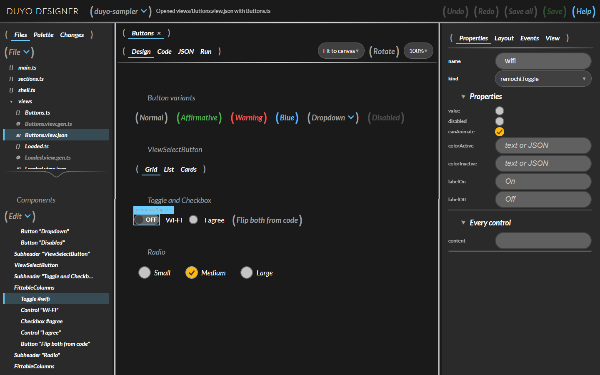
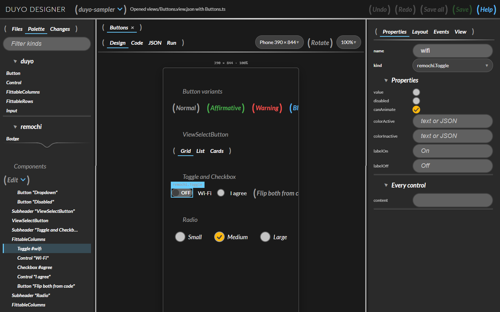
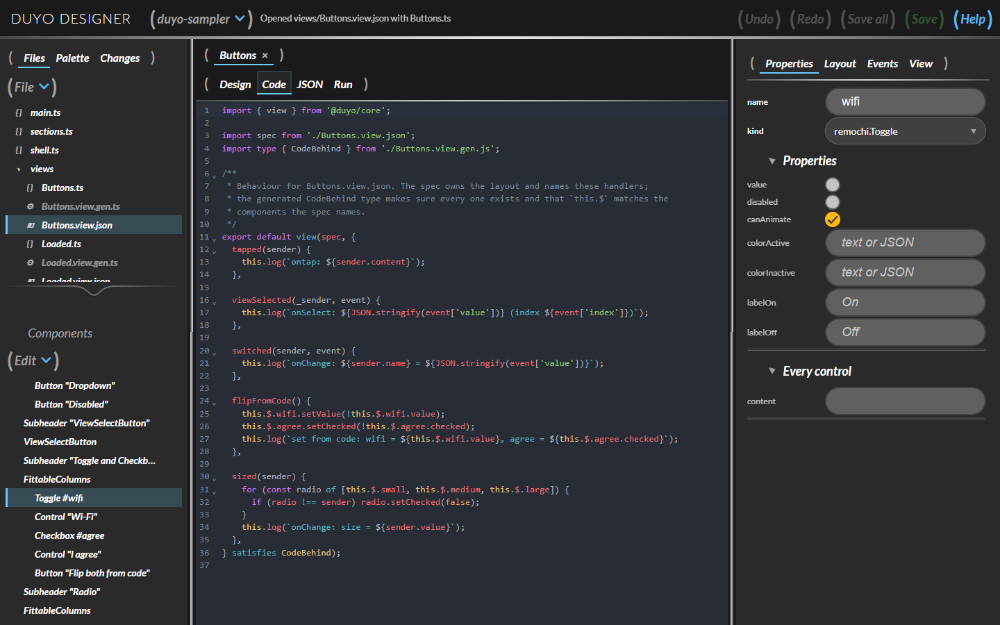
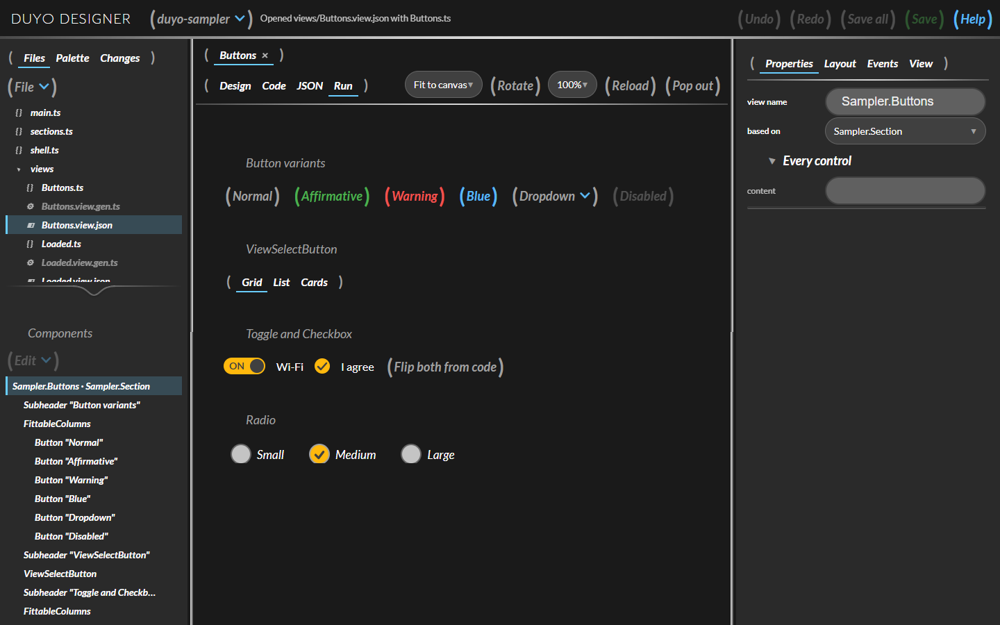

# Duyo

**A modern, Enyo-style component framework.**

[](https://github.com/achunt2143/duyo/releases/latest)
[](LICENSE)

Duyo is a replacement for EnyoJS built for today's tooling. It keeps what made Enyo on HP webOS (and Enyo before 2.6) good: kinds, component ownership, named children (`this.$.name`), published properties, events that bubble to the owner, and the Fittable layout model. The legacy runtime underneath is gone, replaced by TypeScript.



## What you get

- **A TypeScript runtime.** Kinds are resolved as data, not prototype chains, with owner and parent trees, published properties, lifecycle, event bubbling, an action registry and Fittable layout. Definitions can be plain JSON.
- **Pluggable kind packs.** The runtime knows no particular design system. A pack supplies kinds and how to draw them, as Onyx and Mochi did for Enyo, and `adapt()` turns any React component into a kind.
- **[Remochi](https://www.npmjs.com/package/remochi) as the first-party pack.** Every Remochi component is a `remochi.*` kind (`@duyo/remochi`): the webOS look, panels, menus and popups, on React.
- **Views.** A screen's *design* lives in a `.view.json` that people, tools and AI can edit; its *behaviour* lives in a code-behind. Generated types check the two against each other.
- **A visual designer**, in the spirit of Ares: edit views on a live canvas, write their code, run them, and push the result to GitHub.

## A kind, as in Enyo

If you know Enyo, this is already familiar.

```js
import { kind } from '@duyo/core';

kind({
  name: 'App.Counter',
  kind: 'duyo.Control',
  published: { step: 1, value: 0 },
  events: { onChange: '' },
  components: [
    { name: 'count' },
    { name: 'inc', kind: 'duyo.Button', content: '+', ontap: 'increment' },
  ],
  create() {
    this.inherited(arguments);
    this.valueChanged();
  },
  valueChanged() {
    this.$.count.setContent(String(this.value));
  },
  increment() {
    this.setValue(this.value + this.step);
    this.doChange({ value: this.value });
  },
});
```

The API follows Enyo's closely so that Enyo knowledge carries over; [docs/enyo-alignment.md](docs/enyo-alignment.md) lists what maps directly and what deliberately differs.

## A view: design as data, behaviour as code

For a screen, split the kind in two. `Buttons.view.json` is the design, plain data with no code:

```json
{
  "name": "App.Buttons",
  "kind": "duyo.FittableRows",
  "gap": "md",
  "components": [
    { "kind": "remochi.Toggle", "name": "wifi", "onChange": "switched" },
    { "kind": "remochi.Button", "content": "Flip from code", "ontap": "flipFromCode" }
  ]
}
```

`Buttons.ts` is the behaviour. Handler names come from the spec, and `this.$.wifi` is typed from it:

```ts
import { view } from '@duyo/core';
import spec from './Buttons.view.json';
import type { CodeBehind } from './Buttons.view.gen.js';

export default view(spec, {
  switched(sender, event) {
    console.log(`${sender.name} = ${event.value}`);
  },
  flipFromCode() {
    this.$.wifi.setValue(!this.$.wifi.value); // a boolean, from remochi.Toggle
  },
} satisfies CodeBehind);
```

Rename a handler in the spec and forget the code, or misspell `this.$.wifi`, and TypeScript says so. Specs can also arrive at run time, under allow-lists, so a server can send a screen as data. See [docs/views.md](docs/views.md).

Put it on screen with a pack:

```ts
import '@duyo/remochi/css';
import { createRuntime, defaultKindRegistry } from '@duyo/core';
import { basePack, createRenderer, installPack, renderInto } from '@duyo/react';
import { remochiPack } from '@duyo/remochi';

const packs = [basePack, remochiPack];
for (const pack of packs) installPack(defaultKindRegistry, pack);

import './Buttons.js'; // registers App.Buttons

renderInto(createRuntime().create({ kind: 'App.Buttons' }), createRenderer(packs), document.getElementById('root')!);
```

## The Designer

`npm run designer` opens a visual editor for views. It is itself a Duyo app, built from Remochi components.



*Design:* drag any registered kind from the palette onto the canvas or the outline, try the view at phone, tablet or desktop sizes, and edit properties in an inspector generated from each kind's own declarations.



*Code:* the code-behind is one click away, and the arrow beside an event writes its handler for you.



*Run:* the view runs with its real behaviour, in the same device frames.

It also manages projects: a file manager, a folder browser, **cloning from your GitHub repositories**, committing, pushing and opening pull requests through the git you already have, and importing or downloading a project as a **zip**. Details, and how it compares with Ares: [apps/designer](apps/designer/README.md).

## Packages

| Package | |
| --- | --- |
| [`@duyo/core`](packages/core) | Kinds, components, ownership, published properties, events, inheritance. No DOM, no React. |
| [`@duyo/layout`](packages/layout) | `FittableRows` / `FittableColumns` as a pure resolver plus kind definitions. |
| [`@duyo/react`](packages/react) | Kind-pack interface, `adapt()` for porting any React component library, `RuntimeView` / `renderInto`, and a plain-DOM base pack. |
| [`@duyo/remochi`](packages/remochi) | An optional pack: every Remochi component as a `remochi.*` kind, with typed properties. Built with the same public API anyone can use. |
| [`@duyo/views`](packages/views) | Views: validation, generated types, the `duyo-views` CLI, a Vite plugin, a guarded loader for run-time specs. |

| App | |
| --- | --- |
| [Designer](apps/designer) | `npm run designer`: the visual editor, at <http://localhost:5191>. |
| [Sampler](apps/sampler) | `npm run sampler`: every `remochi.*` kind in dark and light, at <http://localhost:5190>. Two sections are written as views. |

## Getting started

```bash
git clone https://github.com/achunt2143/duyo.git
cd duyo
npm install
npm run sampler     # every remochi.* kind
npm run designer    # the visual designer
```

Requirements: Node 18 or later, and React 18 or 19. The packages ship TypeScript source, so use a TypeScript-aware bundler such as Vite. They are not on npm yet; use them from this repository.

To add your own UI library, see [docs/writing-a-pack.md](docs/writing-a-pack.md). Not built yet: a project scaffolder on the new runtime.

## Documentation

| | |
| --- | --- |
| [docs/views.md](docs/views.md) | Views, typed kinds, run-time specs and the designer. |
| [docs/writing-a-pack.md](docs/writing-a-pack.md) | Bring your own UI library. |
| [docs/enyo-alignment.md](docs/enyo-alignment.md) | What maps from Enyo, and what differs. |
| [packages/remochi](packages/remochi/README.md) | The Remochi pack: every kind, the renamed properties, and known Remochi issues. |
| [CHANGELOG.md](CHANGELOG.md) | Release notes. |

## Repository

```
duyo/
├── CHANGELOG.md        # release notes
├── docs/               # guides, and docs/images for the screenshots
├── packages/
│   ├── core/           # kinds, components, events
│   ├── layout/         # Fittable layout
│   ├── react/          # React host, kind packs, adapt()
│   ├── remochi/        # the pack over Remochi
│   ├── views/          # .view.json specs + code-behind: validation, types, CLI, Vite plugin
│   ├── runtime/        # ARCHIVED: vendored Enyo 2.7 + Rollup build
│   ├── vite-plugin/    # ARCHIVED: injects the Enyo bundle as a classic script
│   └── create-duyo/    # ARCHIVED: scaffolder for the above
└── apps/
    ├── designer/       # the visual designer
    ├── sampler/        # every remochi kind, two sections written as views
    └── example/        # ARCHIVED: smoke test for the archived packages
```

## Earlier work

The first iteration vendored Enyo itself (1.0, then 2.7) behind a Vite plugin. It is **archived** and not part of 1.0:

| Tag | What it is |
| --- | --- |
| `archive/enyo-1.0` | Enyo 1.0 (HP webOS 3.0.5) as `packages/runtime`, the original `main` |
| `archive/enyo-2.7-runtime` | Vendored Enyo 2.7, Rollup bundle, `@duyo/vite-plugin`, `create-duyo`, example app |

The 2.7 iteration does not work as shipped (the built bundle never exposes `enyo.kind`), and Enyo 2.6+ dropped the pieces Duyo is modelled on, so it is not being repaired. The `runtime`, `vite-plugin` and `create-duyo` packages and `apps/example` belong to it.

## Attribution

Duyo's programming model and vocabulary come from Enyo (Palm, HP and the Enyo team), released under Apache-2.0. Duyo's own code is written fresh rather than copied from Enyo; the only Enyo source in this repo is the vendored copy in `packages/runtime`.

`packages/runtime` contains the **Enyo JavaScript framework**, originally developed by Palm, Inc. and HP and released under the Apache License, Version 2.0 (see [`packages/runtime/LICENSE-2.0.txt`](packages/runtime/LICENSE-2.0.txt)). Original sources: [enyojs/enyo](https://github.com/enyojs/enyo), [enyojs/enyo-1.0](https://github.com/enyojs/enyo-1.0).

## License

Duyo's own code is licensed under the **Apache License, Version 2.0**.

```
Copyright 2026 achunt2143

Licensed under the Apache License, Version 2.0 (the "License");
you may not use this file except in compliance with the License.
You may obtain a copy of the License at

    http://www.apache.org/licenses/LICENSE-2.0

Unless required by applicable law or agreed to in writing, software
distributed under the License is distributed on an "AS IS" BASIS,
WITHOUT WARRANTIES OR CONDITIONS OF ANY KIND, either express or implied.
See the License for the specific language governing permissions and
limitations under the License.
```
